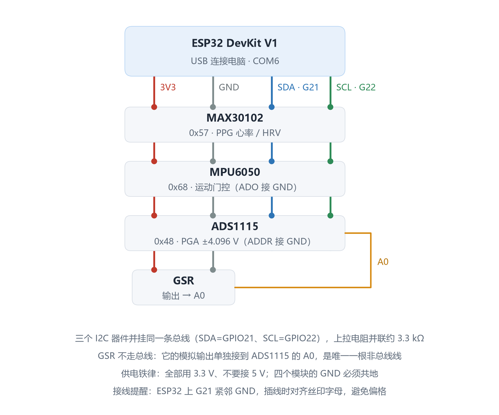

# 四模态面包板接线图（ESP32 + MAX30102 + ADS1115 + MPU6050 + GSR）

> 项目：基于实时心率变异性驱动的主动式情感陪伴系统
> 日期：2026-09-30　适用硬件：ESP32-WROOM-32E / MAX30102 / ADS1115 / GY-521(MPU6050) / 思知瑞 GSR V2



> **上图是"连接关系"抽象图，不是面包板的物理布局。** 它回答的是
> "哪根线该从哪儿到哪儿"，不回答"插在面包板第几行"。
>
> 图中三个要点：
> 1. MAX30102 / MPU6050 / ADS1115 并挂**同一条 I2C 总线**（SDA=GPIO21、SCL=GPIO22），
>    三块模块的上拉电阻并联后约 3.3 kΩ，400 kHz 正常；
> 2. **GSR 不走总线** —— 它的模拟输出单独接 ADS1115 的 `A0`，
>    这是全系统**唯一一根非总线信号线**；
> 3. 四个模块**全部 3.3 V** 且 **GND 必须共地**（详见 §5 供电铁律）。
>
> 同名矢量版：`四模态接线图.svg`（可无损放大 / 直接打印）。
> 重绘脚本：`make_wiring_png.py`（改脚本里的坐标常量即可）。

---

## 1. 实物确认

收到的 5 张照片对应 **3 种器件**：

| 照片 | 器件 | 说明 |
|---|---|---|
| 图 1 + 图 2 | **ADS1115**（同一块，两个角度） | 丝印 `16Bit I2C ADC+PGA V2.0.0`；10 针单排 |
| 图 3 + 图 4 | **MPU6050 / GY-521**（同一块，正反面） | 8 针：`VCC GND SCL SDA XDA XCL AD0 INT` |
| 图 5 | **GSR 皮肤电（思知瑞 SICHIRAY）** | 3.5mm 电极口 + 电源开关 + `BAT±` 焊盘 + `GND/VCC/ADC` 排针 |

ADS1115 引脚（10 针）：
`VDD · GND · SCL · SDA · ADDR · ALRT · A0 · A1 · A2 · A3`

---

## 2. 总接线表

### 公共总线（四根线贯穿所有模块）

| 网络 | ESP32 引脚 | 颜色建议 |
|---|---|---|
| 3V3 | `3V3` | 红 |
| GND | `GND` | 黑 |
| SDA | `GPIO21` | 蓝 |
| SCL | `GPIO22` | 绿 |

### 各模块接线

| 模块 | 引脚 | 接到 |
|---|---|---|
| **MAX30102**<br>I2C `0x57` | `VIN` | 3V3 |
| | `GND` | GND |
| | `SDA` | GPIO21 |
| | `SCL` | GPIO22 |
| | `INT` | 悬空（可选接 GPIO） |
| **ADS1115**<br>I2C `0x48` | `VDD` | 3V3 |
| | `GND` | GND |
| | `SDA` | GPIO21 |
| | `SCL` | GPIO22 |
| | `ADDR` | **GND**（决定地址 0x48） |
| | `ALRT` | 悬空 |
| | `A0` | **← GSR 的 `ADC`** |
| | `A1` | 预留（后续接呼吸带） |
| | `A2` / `A3` | 悬空或接 GND |
| **MPU6050**<br>I2C `0x68` | `VCC` | 3V3 |
| | `GND` | GND |
| | `SDA` | GPIO21 |
| | `SCL` | GPIO22 |
| | `AD0` | **GND**（决定地址 0x68） |
| | `XDA` / `XCL` | 悬空（仅用于外挂磁力计） |
| | `INT` | 可选接 GPIO（DMP 中断） |
| **GSR 皮肤电** | `VCC` | 3V3 |
| | `GND` | GND |
| | `ADC` | **→ ADS1115 的 `A0`** |
| | `BAT+` / `BAT−` | **不接**（用 ESP32 供电） |

### 唯一一条非总线连线

```
GSR 的 ADC ──────────► ADS1115 的 A0      （模拟信号，走黄/橙线区分）
```

GSR 是模拟量输出，**不直接进 ESP32**。

---

## 3. 三条铁律（违反会损坏器件）

### 铁律一：GSR 与 ADS1115 必须同为 3.3V

GSR 模块标称 `3.3-5V`，但**只能用 3.3V**。
若给 5V，其 `ADC` 输出可能接近 5V，直接接进 ADS1115 的 `A0`
会超过 `VDD+0.3V = 3.6V` 的绝对最大额定值 → **损坏 ADS1115 输入级**。

### 铁律二：MAX30102 模块也接 3.3V，不要接 5V

多数 MAX30102 模块带 1.8V 稳压器，`VIN` 接 5V 也能工作，
但模块的 **I2C 上拉电阻会被拉到 5V 电平**，把 5V 灌进 ESP32 的 `GPIO21/22`
→ 长期运行会损伤 IO。**统一 3.3V 最安全。**

### 铁律三：所有 GND 必须共地

四个器件的 `GND` 全部接到同一条 GND 轨。
面包板的上下两条电源轨**默认不连通**，需要用跳线把两侧 GND 轨接起来。

---

## 4. 原理说明：为什么 GSR 必须经 ADS1115

| 原因 | 说明 |
|---|---|
| ESP32 内置 ADC 非线性 | 实测线性度差，且受 WiFi 射频干扰，读数抖动大 |
| GSR 信号本身很弱 | 皮肤电导变化的直流分量大、交流分量小，需要稳定基准 |
| ADS1115 是 16 位 | 分辨率 62.5 µV/LSB（±4.096V 档），比 ESP32 的 12 位（约 800 µV）高一个数量级 |
| 自带 PGA | 可编程增益，后续换更弱信号源（如呼吸带）时不用改硬件 |

**PGA 档位选择**：GSR 输出范围 0~3.3V，必须选 **±4.096V**。
若选 ±2.048V 会在 2.048V 以上削顶；选 ±6.144V 则分辨率浪费。

### 为什么三个 I2C 器件不冲突

| 器件 | 地址 | 决定引脚 |
|---|---|---|
| MAX30102 | `0x57` | 固定 |
| ADS1115 | `0x48` | `ADDR` 接 GND |
| MPU6050 | `0x68` | `AD0` 接 GND |

三个地址互不相同，可并联在同一条 I2C 总线上。

### I2C 上拉电阻

三块模块各自带有约 10 kΩ 上拉，并联后等效约 **3.3 kΩ**。
在 400 kHz 快速模式下属于正常范围，**无需额外加装上拉**。
若通信不稳，优先降低速率到 100 kHz 而不是加电阻。

---

## 5. 供电核算

| 器件 | 典型电流 |
|---|---|
| MAX30102（LED 点亮瞬间） | ≈ 15 mA |
| MPU6050 | ≈ 4 mA |
| ADS1115 | ≈ 0.2 mA |
| GSR | ≈ 1 mA |
| **合计** | **< 25 mA** |

ESP32 开发板板载 3.3V 稳压器通常可提供 500 mA 以上，
带这四个模块**余量充足**，无需外部供电。

> 注意：LD2410D 雷达若仍接在 5V 上，需单独确认其峰值电流（雷达已计划退役）。

---

## 6. GSR 电极佩戴规范

- **部位**：同一只手的**食指 + 中指指腹**（与官方研究一致）
- **方式**：指套电极插入模块的 3.5mm 接口，两指分别套一个
- **状态**：手掌放松、不要握拳、不要碰金属桌面
- **静置**：佩戴后静坐 2~3 分钟再开始记录（皮肤电有适应过程）
- **不要**：涂抹护手霜、手指出汗过多或过干都会影响基线

---

## 7. 接线后立即验证

### 第 0 步（首选）：跑一次全面核验

```bash
mpremote connect COM6 run wire_check.py
```

一次给出 L0 对照组 → L1 电平 → L2 负载特性 → L3 多速率扫描 → L4 器件身份
（写-回读）的完整判定，比手工在 REPL 里敲更省事，也更容易复现。
**任何一项不过，都不要往下走** —— 下面的步骤都假定物理层已通。

### 第 1 步：I2C 扫描，确认三个地址都在

```python
# 在 ESP32 REPL 中执行（或用 mpremote run）
from machine import I2C, Pin
i2c = I2C(0, scl=Pin(22), sda=Pin(21), freq=400000)
print([hex(a) for a in i2c.scan()])
```

**期望输出**：`['0x48', '0x57', '0x68']`

| 缺失地址 | 含义 | 处理 |
|---|---|---|
| 缺 `0x57` | MAX30102 未通 | 查 VIN/SDA/SCL，或未上拉 |
| 缺 `0x48` | ADS1115 未通 | 查 `ADDR` 是否接 GND（接 VCC 会变 0x49） |
| 缺 `0x68` | MPU6050 未通 | 查 `AD0` 是否接 GND（接 VCC 会变 0x69） |
| 全部缺失 | 总线问题 | 查是否共地、SDA/SCL 是否接反 |
| 扫到但读不到数据 | 器件身份不符 | 见下 |

> **⚠️ 一个实测定下的坑：MPU6050 的 `WHO_AM_I`(0x75) 在本批模块上返回 `0x75`
> —— 也就是寄存器地址本身，而非标准的 `0x68`。**
> 因此**不能用 `WHO_AM_I` 判断 MPU6050 是否可用**。本项目的判定方法是
> **寄存器写-回读校验**：向 `SMPLRT_DIV`/`CONFIG`/`ACCEL_CONFIG`/`GYRO_CONFIG`/
> `PWR_MGMT_1`/`PWR_MGMT_2` 六个寄存器写入再读回，**6/6 一致**即可用。
> 多块模块须逐块验，不能验一块就代表全部。
> 这只影响"可用性判定"，正常读写不受影响（驱动里已按此实现）。

### 第 2 步：读 ADS1115 的 A0，确认 GSR 有输出

```python
from machine import I2C, Pin
i2c = I2C(0, scl=Pin(22), sda=Pin(21), freq=400000)
ADS = 0x48

def read_a0():
    # 配置: AIN0 单端, PGA=±4.096V, 单次转换, 128SPS
    i2c.writeto_mem(ADS, 0x01, b'\xC3\x83')
    import time; time.sleep_ms(10)
    raw = i2c.readfrom_mem(ADS, 0x00, 2)
    v = (raw[0] << 8) | raw[1]
    if v > 32767:
        v -= 65536
    return v * 4.096 / 32768.0

while True:
    print('GSR = %.3f V' % read_a0())
    import time; time.sleep_ms(500)
```

**判读**：

| 读数 | 含义 |
|---|---|
| 0.0 V 恒定 | GSR 未供电或 `ADC` 未接到 A0 |
| ≈ 3.3 V 恒定（满量程） | GSR 供电电压不符或电极短路 |
| 1.0~2.5 V 之间，且**深呼吸/受惊时跳动** | **正常** |

**验证技巧**：读数稳定后，让被试**深吸一口气**或**突然拍手**，
皮肤电导会明显变化 → 数值应有可见跳变。若无任何响应，说明电极没贴好。

---

## 8. 固件配置已同步更新

`workbuddy/esp32_firmware/config.py` 已补充新器件的地址与常量，
可直接在后续固件中使用。

---

## 9. 硬件到位后的软件路线

当前 `bridge.py` 已在工作的链路是 **PPG → HRV → 情绪识别**（单模态）。
接入新硬件后的扩展顺序建议：

| 阶段 | 内容 | 预期收益 |
|---|---|---|
| 1 | MPU6050 运动伪迹抑制 | **优先做**。当前 HRV 不稳的主因之一是运动伪迹，做完 RMSSD 会明显更可信 |
| 2 | GSR 接入为第 9 个特征 | 补上**情绪唤醒度**的金指标，突破"高唤醒+不同效价不可分"的模态天花板 |
| 3 | 重训 ML 层 | 特征从 8 维扩到 9~12 维，需重新训练随机森林并重新标定规则表 |
| 4 | 20 人实验 | 真实人体验证"情绪识别 >85%"这一项目指标 |

> ⚠️ 第 1 步（IMU 伪迹抑制）的性价比最高，建议先做完并复测一遍
> `pipeline_check.py`，确认 HRV 指标改善后再做 GSR 融合。

---

## 10. MPU6050 实测结果（2026-09-30，只接加速度计）

### 10.1 硬件体检：全部通过

| 项目 | 实测值 | 判定 |
|---|---|---|
| I2C 地址 | 0x68 在线 | ✔ |
| WHO_AM_I | **0x75**（非标准值） | ⚠ 见下 |
| 寄存器写-回读 | **6/6 项一致** | ✔ 通信完全可靠 |
| 重力模长（静止） | 1.0077 g | ✔ 偏差 +0.008 |
| 加速度噪声 | **0.0037 g** | ✔（阈值 0.25 g 的 1/68） |
| 陀螺零偏 | (+3.95, +1.59, +0.12) °/s | ✔ 规格 ±20 内 |
| 陀螺噪声 | 0.05~2.7 °/s | ✔ |
| INT（GPIO17） | 3 秒 **300** 个上升沿 = 100 Hz | ✔ 与设定完全一致 |
| 芯片温度 | 44.5 °C（die 温度） | ✔ 正常 |

**关于 WHO_AM_I = 0x75**：正品 MPU6050 应为 0x68。但 MPU6050 早已停产，
市售 GY-521 基本是兼容 die。0x75 恰等于 WHO_AM_I 的寄存器地址，
说明该 die 未实现此寄存器（直接回读地址）。
**判据不以此为准** —— 驱动改用**寄存器写-回读校验**（6 项全部一致），
这才是"能不能用"的可靠证据。功能上完全等价，不影响使用。

> 对 20 人实验的意义：如果要买多块，建议**逐块跑一次 `mpu_test_quick.py`**，
> 别假设批次一致。

### 10.2 【最重要发现】只用加速度模长做伪迹抑制会大面积漏检

实测让板子做"手握晃动"（最接近真实使用场景），结果：

| 运动判据 | 阈值 | 实测触发覆盖率 |
|---|---|---|
| ① 加速度模长偏差 `\|\|a\|-1g\|` | > 0.25 g | **约 16%** |
| ② 角速度模长 `\|ω-零偏\|` | > 20 °/s | **约 98%** |

**原因是几何必然，不是实现问题**：旋转**不改变**加速度矢量的模长
（重力大小恒为 1g，转动只改变它作用在哪几个轴上）。
所以 `||a| - 1g|` 对**纯转动天然不敏感** —— 而手腕/手指抖动的主动成分
恰恰就是转动。实测晃动时 dev 多数只有 0.05~0.25 g（常低于阈值），
而同时 |ω| 高达 70~390 °/s。

**结论：伪迹抑制必须至少带上判据②（或③），只用①会放行绝大多数运动段。**

### 10.3 已固化的三判据

`mpu6050.py` 已实现 `is_motion()`，三判据取"或"：

```python
is_motion = (dev_mag > 0.25 g) or (|ω| > 20 °/s) or (tilt > 8°)
```

| 判据 | 物理量 | 敏感的运动 | 备注 |
|---|---|---|---|
| ① 模长偏差 | `\|\|a\| - \|g_ref\|\|` | 平移、碰撞、敲击 | 对纯转动**失效** |
| ② 角速度 | `\|ω - 零偏\|` | **转动**（手部抖动主成分） | 必须先扣零偏 |
| ③ 重力倾角 | 加速度矢量与参考方向的夹角 | 转动、倾斜 | 不需陀螺、不受零偏漂移影响，作②的冗余备份 |

阈值在 `config.py`：`MPU6050_MOTION_G` / `MPU6050_GYRO_DPS` / `MPU6050_TILT_DEG`。

### 10.4 测试脚本与用法

| 脚本 | 用途 |
|---|---|
| `mpu6050.py` | 驱动（初始化 / 原始读取 / 零偏标定 / 三判据运动判定 / INT 通路） |
| `mpu_test.py` | 完整测试：I2C 扫描→芯片识别→寄存器校验→静态质量→实时监视→INT→阈值标定 |
| `mpu_test_quick.py` | 只做硬件体检（跳过监视，约 10 秒）。**每次插拔接线后跑这个** |
| `mpu_test_shake.py` | 30 秒长监视，**验证运动响应**（运行时请持续晃动板子） |

```bash
mpremote connect COM6 run mpu_test.py          # 完整测试
mpremote connect COM6 run mpu_test_quick.py    # 快速体检
mpremote connect COM6 run mpu_test_shake.py    # 运动响应验证
```

> ⚠️ `mpremote run` **不支持**给脚本传参数（会把 `--shake` 当成 mpremote 命令报错），
> 且 MicroPython 的 **ESP32 端口没有 `sys.argv`**。
> 所以模式通过启动器注入全局变量 `MPU_MODE` 传递 —— 见 `mpu_test_shake.py`。

### 10.5 接线注意（GPIO17 曾经的冲突）

INT 原定接 GPIO27，实接在 **GPIO17**。GPIO17 同时是 `RADAR_TX`，
但雷达已拆下，故当前无冲突。`config.py` 已把 `MPU6050_INT_PIN` 改为 17
并保留冲突说明。

> **INT 引脚其实是可选的**：主固件用**轮询**读加速度（与 PPG 主循环同频），
> 完全不需要中断。INT 只在需要精确节拍或低功耗唤醒时才用。
> 若将来同时接回雷达，把 INT 挪到 GPIO27 即可。

---

## 11. 运动门控已集成 + 信号质量门禁（2026-09-30）

### 11.1 第 1 步（IMU 伪迹抑制）已完成

原软件路线表里排第一的"MPU6050 运动伪迹抑制"已落地：

- `hrv.py`：`add_sample(ir, t_ms=None, motion=False)` —— 运动期间**只跑滤波器、
  不记录峰、不产 RR**（源头闸门优于事后清洗）
- `main.py` v0.2：雷达软退役（`RADAR_ENABLED=False`）、与 PPG 同频 10 ms 读 IMU、
  上报 JSON 增 `imu / moving / motion / motion_n / segs`
- 离线验收 `gate_check.py` **5 项全通过**：

| 场景 | 结果 |
|---|---|
| 静止段 | **1.00×（零误伤，最关键）** |
| 运动段 | 未门控 **虚高 1.78×**（35.2 → 62.6 ms）；门控段**一拍不收** |
| 恢复早期 | 2.26×（未门控被运动尾巴污染） |
| 恢复末期 | 1.00× |

> ⚠️ 运动↔静止跳变时**必须清 `last_peak_t` 与 `peaks`**，否则会拿
> "运动前最后一个峰"与"运动后第一个峰"算出跨段假 RR，直接污染 RMSSD。

### 11.2 【重要】但第 1 步做完，HRV 仍然不可信

手指贴放实测：**HR 73 bpm 正常，RMSSD 130 ms、pNN50 61~75%**（静息应 20~50 ms / <10%）。

⇒ **HR 与 HRV 的可信度是解耦的**：HR 只看峰间距均值（抖动被平均掉），
HRV 看逐拍差分（抖动全额进入）。**HR 可信 ≠ HRV 可信。**

`contact_check.py` 三项门禁**全不合格**：

| 指标 | 实测 | 合格线 |
|---|---|---|
| 脉搏/直流 PI | **0.454%** | ≥0.8% |
| 逐拍幅度 CV | **132.3%** | ≤30% |
| RR 抖动指数 | **0.455** | ≤0.08 |

波形层证据：脉搏带（0.7~3 Hz）功率占比仅 **0.01%**（漂移带 99.99%）、
相邻心搏幅度 3 倍差、**双峰形态**（隔 176 ms，幅度 678 vs 679）等。

**结论：不是算法问题，是指腹信号本身不合格。**
运动门控只治"运动伪迹"，对"灌注弱 + 基线漂移"无效 —— 这是两个不同的病。

### 11.3 下一步：先达标再算 HRV

1. 按 §6 的佩戴规范调姿势：**前臂搁桌不悬空 / 指腹轻搭不压紧 /
   完全覆盖窗口 / 加遮光 / 静置 2~3 分钟**
2. 每调一次跑 `mpremote connect COM6 run contact_check.py`，
   **三项全绿**才继续
3. 三项达标后重跑 `finger_test.py`（45 s 门控对照）验证真实数据上的门控效果
4. 若怎么调都到不了 PI ≥ 0.8% → 说明指腹 PPG 的灌注天花板就在这，
   应把重心转到 **GSR**（情绪唤醒度金指标），HRV 退为辅助量

### 11.4 GSR 优先级提示（与上面这条呼应）

从 11.2 的结论反推：**GSR 不只是"第 9 个特征"，它是本项目情绪识别的关键依赖**。
PPG/HRV 在接触式采集下的可信度受限，而 EDA/GSR 对唤醒度的响应幅度大、
对接触质量的要求也远没有 PPG 苛刻。**建议下一件实事就是 GSR + ADS1115 接线测试。**

---

## 12. 故障排查：MAX30102 不亮灯 / I2C 扫描为空

> 本节由 2026-10-01 的一次真实故障沉淀而来，含**一条被推翻了两次的错误结论**，
> 值得完整读一遍 —— 排查 I2C 时的两次误判都很有代表性。

### 12.1 先纠正一个前提：不亮灯 ≠ 接线错

**MAX30102 复位后 LED 是关着的。** 三个相关寄存器的复位值都是 `0x00`：

| 寄存器 | 地址 | 复位值 | 作用 |
|---|---|---|---|
| `LED1_PA` | `0x0C` | `0x00` | 红光 LED 电流（0 = 不发光） |
| `LED2_PA` | `0x0D` | `0x00` | 红外 LED 电流（0 = 不发光） |
| `MODE_CONFIG` | `0x09` | `0x00` | 0 = 关闭；写 `0x03` 才是 SpO2 模式 |

必须由程序**依次**写入这三者，灯才会亮（见 `max30102.py:130-135`）。
所以在 `main.py` 里，一旦 `present()` 读到的 PART_ID 不是 `0x15`，
`ppg_ok` 就被置 `False`，后面 `read_fifo()` 永不执行 —— **灯永远不亮**。

⇒ **"灯不亮"不能证明接线错**，它也可能是"程序根本没跑到那一步"。
真正要测的是 **I2C 通不通**。

补充两点，避免把"正常"当成"故障"：

- SpO2 模式下红光是 **100 Hz、411 µs 脉宽**的闪烁，占空比只有约 8%，
  日光下本来就**很暗**，肉眼容易以为没亮
- 红外光（880 nm）**肉眼几乎不可见**。用**手机前置摄像头**对着传感器窗口，
  能看到紫白色光点 —— 这是判断"到底亮没亮"最可靠的办法

### 12.2 五个诊断工具

均位于 `workbuddy/esp32_firmware/`，已部署到板子上。

| 脚本 | 用途 | 命令 |
|---|---|---|
| **`wire_check.py`** | **四模态接线全面核验（首选）** —— L0 对照组 / L1 电平 / L2 负载特性 / L3 多速率扫描 / L4 器件身份（写-回读） | `mpremote connect COM6 run wire_check.py` |
| `max30102_check.py` | 分层诊断（引脚电平 → 扫描 → 型号 → 强制点灯 → 读温度） | `mpremote connect COM6 run max30102_check.py` |
| `bus_probe.py` | 总线物理层探针，定量判断"是否被硬拉低 / 有无外部上拉" | `mpremote connect COM6 run bus_probe.py` |
| `bus_recover.py` | 总线恢复（打 9 个时钟），区分**从机挂死**与**硬接地** | `mpremote connect COM6 run bus_recover.py` |
| `bus_watch.py` | 90 秒实时监视，**边拔模块边看** SDA 何时恢复 | `mpremote connect COM6 run bus_watch.py` |

> **`wire_check.py` 的两个设计约束**（别改）：
> ① 每条"异常"结论都配一个**对照组** —— 先对空闲 GPIO（25/26/27/32/33）
> 做同样测量，证明方法在本芯片上有效；对照组不过，后面的结论一律作废。
> ② L4 读器件身份时，MPU6050 的 `WHO_AM_I` 在本批模块上**非标准**
> （返回 0x75 = 寄存器地址本身），因此改用**写-回读 6 个寄存器**做可用性判定，
> 而不是靠身份寄存器。

### 12.3 【方法论】三次误判 —— 都值得记住

> 这次排查连着推翻了自己三个结论。它们的成因相同 ——
> **测量手段本身改变了被测对象，或读到的根本不是被测量**。
> 结论：**测总线时，测量手段必须比总线更弱；判断电平必须走输入通路。**

**误判一：用开漏模式测"空闲电平"，测到的是自己拉的电平。**

第一次写 L1 时用了 `Pin(n, Pin.OPEN_DRAIN, Pin.PULL_UP)` 去读电平。
问题在于 MicroPython 构造引脚时若不显式传 `value`，**输出锁存器的初值
是不确定的**；开漏模式下 `value=0` 就是主动拉低。于是"读到 0"可能是
自己造成的。

修正方法：**只用纯输入模式**测空闲电平：

```python
p = Pin(n, Pin.IN, Pin.PULL_UP)     # 只输入, 绝不驱动总线
up = p.value()                       # 上拉读 0  -> 被硬拉低
p = Pin(n, Pin.IN, Pin.PULL_DOWN)
dn = p.value()                       # 下拉读 1  -> 外部上拉在位
```

并且做了一次**自校验**来确认结论：把 `OPEN_DRAIN` 分别置于默认态和
`value(1)` 态各读一次。两者读数一致 ⇒ 说明读到的确实是外部真实电平，
第一次的结论侥幸成立。**但方法本身必须改**，不能靠侥幸。

**误判二：用"把 SCL 拉低看 SDA 是否跟着低"测短路，得到假阳性。**

若 SDA 本身恒为 0，那么"拉低 SCL 后 SDA 仍为 0"是**必然结果**，
这个测试**没有任何鉴别力**，却会报出"SDA 与 SCL 短路"。

改用**负载特性比较**（全程只做输入）：

- SCL：内部下拉读 1 ⇒ SCL 上有外部上拉（约 3.3 kΩ）
- SDA：内部上拉读 0、内部下拉读 0 ⇒ 下拉远强于上拉
- 若 SDA 与 SCL 是同一节点，SCL 的 3.3 kΩ 上拉至少会把 SDA 抬到中间电平
- 实测 SDA 仍为 0 ⇒ **二者不是同一节点**

**误判三（2026-10-01 新增）：把引脚设为输出后 `p.value()`，读到的可能不是焊盘。**

为了判断"GPIO21 是不是坏了"，我先写了一版 L2：把 GPIO21 设为 `Pin.OUT`
驱 1，再读 `p.value()`，读到 1 就宣布"引脚驱动器完好"。

**这个结论是无效的。** MicroPython 对**输出模式**的引脚，`Pin.value()`
读回的很可能是**输出锁存器**（output latch）而不是焊盘真实电平 ——
那样驱 1 必然读回 1，驱 0 必然读回 0，**测不出任何信息**。

修正后的做法：**"驱到某电平 → 切成输入 → 观察它自己回到哪里"**。

```python
p = Pin(SDA, Pin.OUT); p.value(1); time.sleep_ms(30)
Pin(SDA, Pin.IN, Pin.PULL_DOWN); time.sleep_ms(30)
t2 = Pin(SDA, Pin.IN, Pin.PULL_DOWN).value()
# t2 == 0 -> 撒手后塌回 0, 确认存在一条主动拉向 0 的通路
# t2 == 1 -> 之前读到 0 另有原因(例如引脚其实悬空、内部上拉失效)
```

这一步的意义是**排除第二种解释**：L1 只能证明"内部上拉拉不动它"，
但那既可能是"有东西把它拉向 0"，也可能是"引脚根本没接上东西、
而内部上拉本身是坏的"。T2 撒手后塌回 0，才把后一种解释排除掉。

**三次误判的共同点**：测量手段本身改变了被测对象，或读的根本不是被测量。
**测总线时，测量手段必须比总线更弱；判断电平必须走输入通路。**

### 12.4 【方法论】硬接地 vs 从机挂死：靠"打时钟"区分

这是一个很容易搞混的坑 —— **I2C 从机在 ACK 相位也是用开漏把 SDA 拉低的，
阻抗只有几十欧，与"导线直接接地"在电平上完全无法区分。**

第一次看到"SDA 被硬拉低、下拉阻抗 < 1.1 kΩ"就直接下结论"是导线接地"，
这是**不严谨的**：从机卡在 ACK 时同样是这个量级。

**正确的判别手段是 I2C 规范里的 bus clear 流程**（`bus_recover.py`）：
释放 SDA，向 SCL 连打 9 个时钟脉冲（8 位 + 1 个 ACK），补一个 STOP。

| 打时钟后的现象 | 结论 | 处理 |
|---|---|---|
| SDA 恢复为高 | **从机卡在 ACK**（总线挂死） | 重扫总线；若无效则**给所有模块断电 3 秒冷启动** |
| SDA 仍为低 | **硬接地**，时钟救不回来 | 见 §12.5 物理排查 |

全程只用开漏 + 内部上拉（约 45 kΩ），即使线上真有短路也只会流过
约 73 µA，不会烧任何东西。

### 12.5 硬接地的物理排查（按概率排序）

| 排序 | 可能原因 | 怎么查 |
|---|---|---|
| 1 | **SDA 杜邦线插进了 GND 那一列**，或与 GND 同插一排孔 | 面包板同一**横排 5 个孔是互通的**，这是最容易犯的错。拔出来单独插一个空排 |
| 2 | **模块排针的焊桥** | SDA 与 GND 在模块上常**相邻**。手焊的排针很容易在两者间留一个锡球 → 万用表蜂鸣档量 SDA–GND |
| 3 | SDA 线接到了某个模块的 GND 引脚 | 逐根核对，**看丝印字母而不是看引脚位置**（见 §12.6） |
| 4 | 面包板某孔内部短路 / 劣质杜邦线内部短路 | 换一个孔、换一根线试 |
| 5 | 模块本体损坏（ESD / 曾接过 5 V） | 拔掉它，若 SDA 恢复即确认 |
| 6 | ESP32 的 GPIO21 已损坏 | 把 SDA 线**悬空**（不接任何东西）再测；仍为 0 则板子问题 |

**最快路径 —— 隔离法 + 实时监视**：

```bash
mpremote connect COM6 run bus_watch.py     # 会跑 90 秒
```

保持脚本运行，**一次只拔一根线/一个模块**，屏幕一旦打印
`[*** 跳变 ***] SDA 0 -> 1`，刚才拔掉的就是元凶。

### 12.6 模块丝印：三种引脚顺序，别按位置照搬

| 版本 | 引脚顺序 | 陷阱 |
|---|---|---|
| A | `VIN` `GND` `SCL` `SDA` `INT` | — |
| B | `VCC` `GND` `SDA` `SCL` `INT` | **SDA/SCL 与 A 相反** |
| C | `VCC` `SCL` `SDA` `GND` `INT` | GND 位置也不同 |

手里拿着 A 版的接线习惯去接 B 版模块，就会把 SDA/SCL 接反。
**永远看丝印字母，不看引脚位置。**

### 12.7 实测案例（2026-10-01）

重新接线后 MAX30102 不亮灯。**两轮**实测数据如下。

**第一轮（重新接线前）**

| 项 | 结果 | 判读 |
|---|---|---|
| SDA(GPIO21) 内部上拉 | **0** | 被硬拉低 |
| SDA 内部下拉 | **0** | 下拉强度远超 3.3 kΩ 上拉 ⇒ 阻抗 < 约 1.1 kΩ |
| SCL(GPIO22) 内部上拉 / 下拉 | 1 / 1 | **正常，外部上拉在位** |
| 扫描 @400 k / 100 k / 50 kHz | 全部无应答 | 三档速率全挂 ⇒ 非速率问题 |
| 9 个时钟脉冲（bus clear） | SDA **仍为 0** | ⇒ **硬接地**，非从机卡死 |
| `boot.py` | 原厂空模板 | 排除 ESP32 侧代码拉低 |
| 硬复位后复测 | 与上完全一致 | 排除引脚锁存 |

**第二轮（"已接完全部线"后，用 `wire_check.py` 复测）**

| 层 | 项 | 结果 | 判读 |
|---|---|---|---|
| L0 | 对照 GPIO 25/26/27/32/33 | 上拉=1 下拉=0 **5/5 通过** | 测量方法在本芯片上**有效**，后续结论有资格成立 |
| L1 | SDA(GPIO21) | 上拉=0 下拉=0 悬空=0 | **仍被强拉低** |
| L1 | SCL(GPIO22) | 上拉=1 下拉=1 悬空=1 | 仍正常 |
| L2 | T2 驱 1 后撒手（内部下拉） | **0** | 存在**主动**拉向 0 的通路（判为【甲】） |
| L2 | T3 驱 1 后撒手（完全悬空） | **0** | 同上，且排除"引脚悬空" |
| L3 | 400 k / 100 k / 50 k / 10 kHz | **四档全无应答** | 物理层不通 |

**结论**：SDA 那条线上存在一处直接接地。**"重新接线"没有改变这一点** ——
两轮数据完全一致，说明故障点仍在原处（或在同一根线上）。

**一个值得注意的推论**：SCL 上检测到外部上拉 ⇒ 说明**至少有一个模块
是接上且上拉电阻在位的**。既然该模块的上拉同时在 SDA 上（并联约 3.3 kΩ），
SDA 却仍读逻辑 0 ⇒ 接地通路的阻抗远低于 3.3 kΩ ⇒ **优先查导线与焊桥，
而不是"模块没接上"**。

**一个容易被忽略的几何事实**：多数 ESP32 DevKit 上，**GPIO21 的相邻排针
就是 GND**。也就是说"插偏一格"这个最常见的失误，恰好会得到一个与硬接地
完全同形的现象。**排查时看丝印字母，不要凭位置。**

### 12.8 排查顺序（可直接照做）

1. `mpremote connect COM6 run wire_check.py` —— 一次拿全 L0~L4 判定
2. 若 L1 的 SDA 为 0：`mpremote connect COM6 run bus_recover.py`
   —— 先排除从机挂死（打时钟后恢复 ⇒ 从机挂死，否则是硬接地）
3. 仍是低：**把 SDA 那根杜邦线从 GPIO21 上拔下来悬空**，重跑第 1 步
   - L1 恢复为 1 ⇒ GPIO21 完好，问题在那根线 / 面包板 / 模块侧 → 转第 4 步
   - L1 仍为 0 ⇒ GPIO21 引脚已损坏 → 转第 5 步
4. 线束密集、目视顺线不可行时，改用 **§12.9 的三步物理二分法**
   （比"拔一根看一次"更快收敛，且每一步的失败都有明确含义）
5. 换脚预案：把 `wire_check.py` 顶部 `SDA = 21` 改成 `23`（或 18/19/5/16），
   杜邦线挪到新脚；`main.py` / `bridge.py` 侧同步改 `I2C_PIN_SDA`
6. 修好后：`mpremote connect COM6 run max30102_check.py`
   —— **L2 扫到 `0x57` → L4 能点灯 → L5 温度合理**，三关全过才算真修好

> **别用"灯亮没亮"当判据。** MAX30102 的 `LED1_PA`(0x0C) / `LED2_PA`(0x0D) /
> `MODE_CONFIG`(0x09) 复位值全是 `0x00`，不上电写这三处，**灯本来就不该亮**。
> 唯一可信的入口是 `i2c.scan()`。

### 12.9 三步物理二分法（线束密集时的推荐做法）

**判据优先级：物理断开 > 电气测量 > 视觉核对。**
现场线一多（线在面包板上来回横穿交叉），**目视顺线排查必然失败** ——
这不是"不够仔细"，而是方法本身不适用。

用 `bus_state.py`（只输出两行：SDA/SCL 各自的上拉/下拉读回 + 一句人话结论）
串起下面的动作，**每做完一步就重跑一次**：

| 步 | 动作 | 预期 | 不符时的结论 |
|---|---|---|---|
| 1 | 把 SDA 线在**面包板那一头拔空**（引脚端保持插着） | 恢复 1 | 该**线材内部**短路 → 换线 |
| 2 | 把悬空端插到面包板上一**排空行**（5 孔内无其他线） | 保持 1 | 该**排孔内部**短路 → 换排 / 换面包板 |
| 3 | 把各模块的 SDA 线**逐根**插回这排空行，每插一根测一次 | 一直是 1 | 谁让它变 0，谁是元凶（模块焊桥或该线插错位） |

### 12.10 已排除的假设（避免重复走弯路）

| 假设 | 排除依据 | 日期 |
|---|---|---|
| 引脚未上拉 / 速率太高 | 400 k / 100 k / 50 k / 10 k **四档全无应答** | 10-01 |
| ESP32 侧代码拉低 | 板载 `boot.py` 为原厂空模板 | 10-01 |
| GPIO21 引脚损坏 | 把线从 G21 **拔下悬空** → SDA 立刻恢复 1 | 10-01 |
| 测量方法失真（对照失败） | L0 对照组 5 个空闲脚 **5/5 通过** | 10-01 |
| 从机卡在 ACK 相位死握 SDA | 9 时钟 bus clear 后 SDA **纹丝不动** | 10-01 |
| **ADS1115 的 ADDR 接地线** | 用户拔掉该线后复测，**SDA 仍为 0** | 10-01 |
| "再重新接一遍线" | 用户完整重接后，读数与重接前**逐字相同** | 10-01 |

> **一个高信息量的推理**：若"把线全部重做一遍，故障读数逐字不变"，
> 那么故障必然落在**不随重接而改变的部件**上 —— 模块焊桥 / 面包板某排内部短路 /
> 线材本身，而**不是**"插错了哪一格"。
> 此时反复"再检查一遍接线"是无效的，应直接跳到**焊接与孔位**的物理排查。

