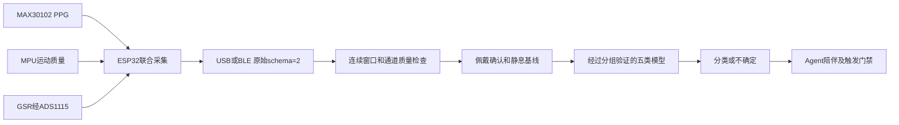

# 当前硬件→心理助手Agent对接说明

更新：2026-10-04。现用MAX30102、MPU、ADS1115/GSR，无LD2410B/LD2410D雷达。

## 唯一生产通路



所有模块3.3V并共地；I²C SDA21/SCL22，MAX=0x57、ADS=0x48、MPU=0x68。GSR ADC输出接ADS A0。部署、回滚、模块配置见esp32_firmware/README.md。

## 启动

```powershell
Set-Location 'D:\大创心理助手\心理助手Agent-1\hrv_companion_agent(1)\hrv_companion_agent'
python run_api.py
```

另一终端：

```powershell
Set-Location 'D:\大创心理助手\workbuddy\esp32_firmware'
python gateway.py --port COM6 --user participant01
```

打开 http://127.0.0.1:8000 ，参与者编号设为participant01。用Chrome/Edge网页BLE连接时不需要USB网关。USB和BLE同时上报同一包不会重复积累心搏。每个用户只应绑定一个当前设备会话。

原bridge.py --port COM6现转入同一个网关。--baseline/--calib的旧人群锚点缩放不用于真实硬件；新基线通过网页保存。bridge --port SIM、firmware_sim和pipeline_check只用于演示自洽性，不用于准确率验收。

## 佩戴和个人基线

1. 设备上电时让MPU静止完成标定；将PPG贴合指腹，确认GSR电极佩戴稳定。
2. 网页点击“已佩戴好电极”，等待120秒电极稳定期。电压正常不能证明电极接触，确认来自佩戴者。
3. 继续静息，使完整约60秒连续窗口位于稳定期之后；确认自己平静，再点击保存基线。
4. 基线绑定当前参与者、设备和boot。重新佩戴应重新确认；重启或超过5秒没有新数据会撤销校准。
5. 再采集约60秒，保存独立自评。该窗口须与基线不重叠，相邻标签也不可重叠。

自动质量筛查不能检测所有电极脱落或模拟前端故障；此类变化仍需要佩戴者报告、接触对照和标定验证。不会从模型的“平静”预测自动建立静息基线。

## 协议与特征

| 原始字段 | 含义 |
|---|---|
| schema=2 | 采集契约版本，不是模型版本 |
| device_id / boot_id / seq / device_ms | 设备、开机会话、包身份和开机毫秒 |
| segment_id / continuity | 连续心搏片段，不跨读错/运动/丢拍拼接 |
| ibi_events | [唯一心搏ID,间期结束毫秒,间期毫秒] |
| eda_samples | [设备毫秒,原始电压V]，约20Hz |
| ppg / imu / ads / motion_known / moving | 新鲜健康状态，IMU失败不解释为静止 |
| sig_quality / pi / sample_rate / expected_rate | PPG及采样质量；缺字段不默认为合格 |
| errors / error_totals / transport | 本包错误、累计错误、通信丢弃 |

PC重算时域PRV和GSR统计，约60秒完整窗口后才评估。13维固定顺序为hr_bpm、sdnn_ms、rmssd_ms、pnn50_pct、gsr_mean_v、gsr_std_v、gsr_slope_v_s、gsr_step_rms_v、gsr_range_v、motion_fraction、hr_relative、rmssd_relative、gsr_relative。

相对特征=(当前−基线)/max(|基线|,量纲下限)，下限HR=1bpm、RMSSD=5ms、GSR=0.02V。固定模式为ppg-gsr-imu-baseline-voltage-v2。训练与在线使用同一转换。原始GSR仍是电压，不作未经标定的电导/SCR解释。

无雷达后，真实硬件rr_bpm和lf_hf当前为未知。60秒PRV不能直接冒充可靠呼吸或标准5分钟频域特征；旧RSA计算仅保留在显式演示中。后续引入可靠长窗口频域或新呼吸传感器需要升级特征契约并重训。

## 分类与训练

五类需要独立自评真值。使用data/multimodal_labels.jsonl训练，不能使用系统情绪时间线自动标签、合成数据、旧MAD ECG特征替代当前硬件。

```powershell
python models/train_multimodal.py --data data/multimodal_labels.jsonl --output models/multimodal_emotion.joblib
```

按受试者留出评估，训练侧分组概率校准。输出evaluation.json含普通准确率、balanced accuracy、macro F1、最低类别召回、覆盖率、接受样本准确率、混淆矩阵和发布阻断原因。不足20人或测试每类样本不足不能启用生产模型。

网页“信号检查通过”只说明工程筛查合格；“模型尚未启用”时仍是不确定。有效推理还需训练域内、最大概率≥0.7、前两类差≥0.15，并连续约10秒确认。拒判时风险未知，不写入情绪时间线，不触发生理干预；文字陪伴仍可运行。

## 实验验收

本版响应分两种：稳定窗口后的传输/推理耗时，与首次校准/窗口积累/10秒确认时间。不能把60秒窗口称为1秒完成分类。需要≥20人真实实验、跨受试者测试、运动和失联场景、与ECG参考核对、GSR接触/已知输入对照；满意度和AB实验单独评估。

当前服务用于本机单进程研究，标签按文件锁写入。公开服务或多进程需要认证、统一事务存储和设备归属管理。2026-10-05已备份、部署并回读验证开发板；USB/BLE真实包均进入API，双通路重复包被拒收。峰值缓存内存优化后，非佩戴USB230包/BLE173包无序号缺口，实际MTU23；再次佩戴USB231包连续且API全部接受。启动首包PPG4/FIFO4、seq122有IMU1，ADS/clock为0。PI中位数0.251%、最大0.379%，sig_quality最大0.49，全部窗口未通过质量门控。用户独立自评平静并同意保存合格基线，但没有获得合格窗口，未保存基线或训练标签，输出“不确定”。372项测试通过，没有新人体实验准确率结果。详见code-review-2026-10-04/实机验收-2026-10-05.md。
